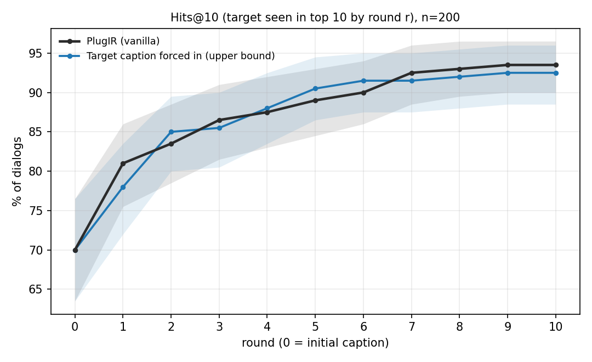

# v3 results: 200 random dialogs, full 10 rounds (Nov 13, 2026)

Setup: 200 VisDial val dialogs drawn with seed 20261112 (`configs/subsets/random200_seed20261112.json`),
Qwen3.5-9B 4-bit via Ollama on a Colab L4, BLIP ITM-large over the 50k COCO unlabeled2017 corpus,
notebook `experiments/AgentIR_v3_200dialogs.ipynb`. Hits@10 = target in the top 10 at any round so far;
Recall@10 = target in the top 10 at that round. Intervals are paired bootstrap 95% CIs over dialogs.

| Method | Hits@10 r5 | Hits@10 r10 | Recall@10 r10 | Δ Hits@10 r10 vs vanilla | Run time |
|---|---|---|---|---|---|
| PlugIR (vanilla) | 89.0 | 93.5 | 85.0 | – | 278 min |
| Target caption forced into the 10 shown (upper bound) | 90.5 | 92.5 | 83.5 | −1.0 [−3.5, +1.5] | 278 min |
| History pool (top-200 per round, top-100 clustered) | 87.5 | 93.0 | 83.5 | −0.5 (CI pending matched-baseline report) | 200 dialogs, BRI 0.726 |
| Fixed top-100 pool (matched baseline) | 89.0 | 92.5 | 86.5 | −1.0 (history pool vs this baseline: +0.5) | 200 dialogs, BRI 0.736 |
| Fixed top-500 pool | 90.5 | 93.5 | 84.5 | 0.0 | 200 dialogs, BRI 0.650 |
| Best-ranked representatives | 87.5 | 93.0 | 84.5 | −0.5 | 200 dialogs, BRI 0.756 |

## Cluster diagnostics on vanilla PlugIR (`e5_cluster_diagnostics_plugir.json`)

- Target is inside the clustered pool: 100% of dialogs at least once; 94.5–100% of rounds.
- Target is one of the 10 shown representatives in at least one round: **23.0%** (46/200 dialogs);
  per round 0.5–12%, rising in late rounds as the pool shrinks.
- Final Hits@10: 95.7% when the target was ever shown vs 92.9% when it never was.
- Rounds just before the target enters the top 10 (n=47) vs other open rounds (n=220):
  similarity of target to nearest shown representative 0.723 vs 0.766; target rank 45 vs 111.
  AUC of that similarity for predicting entry = 0.365.
- Rebuilt clusters reproduce the logged representatives in 99.95% of cases.
- Hits@10 (93.5) minus Recall@10 (85.0) at round 10: 8.5% of dialogs found the target and then lost it.
  `figs/clusters_qid31.png` is one example (rank 3 at round 6, rank 33 at round 10).

Raw runs (sessions.jsonl, per-round rows) are in the team Drive under `agentir-experiments/runs/v3_*`.
